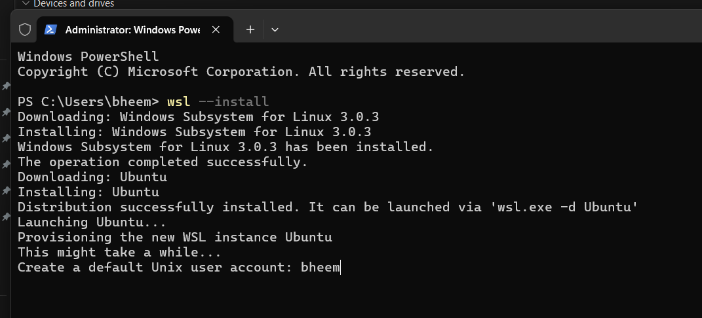

# Exercise 1: Hello Pod with Kubernetes

## Objective
Run the Nginx web server in a Kubernetes Pod and access it through a NodePort Service. Nginx represents a simple Zepto storefront and delivery status application for this exercise.

## Environment
- Windows with PowerShell
- Docker Desktop using the WSL 2 backend and Linux containers
- Minikube, kubectl, and Git

## Steps
Start Docker Desktop and confirm the Docker engine is available:

```powershell
docker version
```

Start the local Kubernetes cluster and check its status:

```powershell
minikube start --driver=docker
minikube status
kubectl get nodes
```

Create the Nginx Pod and wait for it to become ready:

```powershell
kubectl run hello-k8s --image=nginx --port=80
kubectl wait --for=condition=Ready pod/hello-k8s --timeout=180s
kubectl get pods -o wide
```

Expose the Pod and open the application:

```powershell
kubectl expose pod hello-k8s --type=NodePort --port=80 --target-port=80
kubectl get services
minikube service hello-k8s
```

Keep the Minikube service terminal open if it runs a tunnel for browser access.

## Verification
Mark these items after checking the actual results:

- [ ] Minikube is running and its node reports `Ready`.
- [ ] The `hello-k8s` Pod reports `1/1` ready and `Running`.
- [ ] The `hello-k8s` Service has type `NodePort`.
- [ ] The browser displays the **Welcome to nginx!** page.

Save a browser screenshot as `evidence/nginx-welcome.png`. Once saved, embed it here using:

```markdown

```

## Setup Issue Encountered
Docker Desktop could not start because the Virtual Machine Platform feature was disabled and WSL was missing. Setup steps included enabling Virtual Machine Platform, restarting Windows, and installing WSL. Confirm Docker is working with `docker version` before starting Minikube.

## Saved Configuration
If `pod.yaml` and `service.yaml` have been saved in this folder, recreate the resources with:

```powershell
kubectl apply -f pod.yaml
kubectl apply -f service.yaml
```

The YAML files, screenshot, and this README document the exercise for Git submission. These documentation files are additions to the original exercise instructions.

## Learning
A Pod runs the Nginx container, while a Service provides access to it. A standalone Pod does not provide automatic replacement after deletion or replica scaling; a Deployment is normally used for those capabilities.

## Optional Cleanup
After recording the results:

```powershell
kubectl delete service hello-k8s
kubectl delete pod hello-k8s
minikube stop
```
