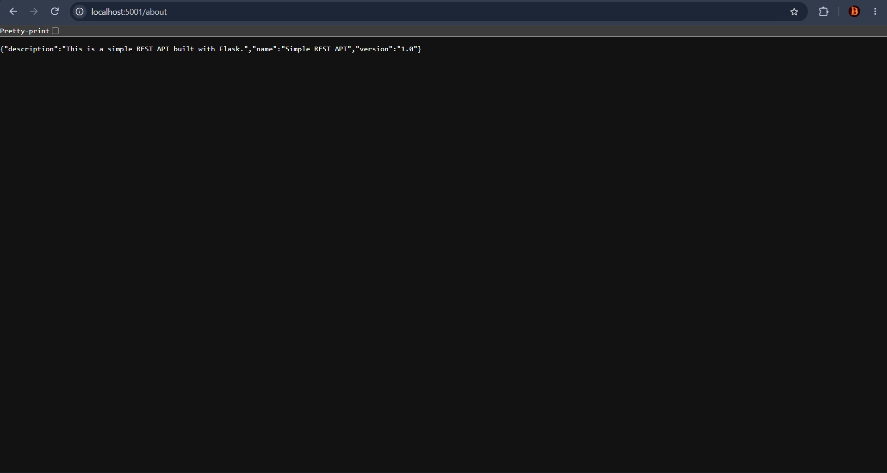

# Exercise 4: Docker Networking with Multiple Containers

## Objective
Create a user-defined bridge network, run Flask, MySQL, and Redis containers on it, and verify communication using container names. Publish the Flask API to Windows localhost.

## Environment
Windows PowerShell and Docker Desktop using Linux containers. Minikube is not required.

## Components
| Container | Image | Purpose | Container port |
| --- | --- | --- | --- |
| `flask` | `flask-api` | Flask REST API using Python 3.12 and Flask 3.1.2 | 5001 |
| `mysql` | `mysql:8.4` | MySQL database server | 3306 |
| `redis` | `redis:7` | Redis server | 6379 |

All three connect to `my-bridge-net`. Only Flask is published to Windows, at `127.0.0.1:5001`. The supplied Flask application serves `/about`; it does not execute database queries or use Redis as an application cache.

## Files
- `app.py`: Flask application listening on `0.0.0.0:5001`, with debug mode disabled.
- `requirements.txt`: Flask dependency.
- `Dockerfile`: builds `flask-api` and installs `iputils-ping` for connectivity checks.
- `evidence/`: saved outputs and browser screenshot.

## Run the Exercise
Run these commands in PowerShell from the `exercise-4` folder. Docker Desktop must be running. These launch commands assume the lab network and container names do not already exist.

### Create and Inspect the Network
```powershell
docker version
docker network create --driver bridge my-bridge-net
docker network ls
docker network inspect my-bridge-net
```

### Build the Flask Image
```powershell
docker build -t flask-api .
```

### Start MySQL
Set a nonempty temporary password in the same PowerShell window used to launch MySQL. The check below must return `False` before proceeding.

```powershell
$env:MYSQL_ROOT_PASSWORD = Read-Host "Enter a temporary MySQL lab password"
[string]::IsNullOrWhiteSpace($env:MYSQL_ROOT_PASSWORD)
docker run -d --name mysql --network my-bridge-net -e MYSQL_ROOT_PASSWORD mysql:8.4
Remove-Item Env:MYSQL_ROOT_PASSWORD -ErrorAction SilentlyContinue
docker logs --tail 40 mysql
```

Wait for MySQL to report that it is ready for connections. The actual password is not included in this repository. Removing the environment variable clears it from this PowerShell session; the launched container retains its configured environment.

### Start Redis and Flask
```powershell
docker run -d --name redis --network my-bridge-net redis:7
docker run -d --name flask --network my-bridge-net -p 127.0.0.1:5001:5001 flask-api
docker ps
```

### Test the API
Open [the about endpoint](http://localhost:5001/about) or run:

```powershell
curl.exe --fail http://localhost:5001/about
```

Expected response:

```json
{
  "name": "Simple REST API",
  "version": "1.0",
  "description": "This is a simple REST API built with Flask."
}
```

The application has no `/` route; use `/about`.

### Test Container Networking
```powershell
docker exec flask ping -c 4 mysql
docker exec flask ping -c 4 redis
docker network inspect my-bridge-net
```

These commands run ping inside Flask's container, demonstrating Docker DNS name resolution and network reachability.

For additional TCP checks, run:

```powershell
docker exec flask python -c "import socket; s=socket.create_connection(('mysql',3306),timeout=5); print('MySQL TCP connection successful'); s.close()"
docker exec flask python -c "import socket; s=socket.create_connection(('redis',6379),timeout=5); print('Redis TCP connection successful'); s.close()"
```

TCP checks establish port reachability, not authenticated database operations. No saved TCP-test result is claimed here.

## Observed Results and Evidence
| Check | Saved result | Evidence |
| --- | --- | --- |
| Containers | Flask, MySQL, and Redis were all `Up` | [Running containers](evidence/running-containers.txt) |
| Flask API | Returned the expected application name, version, and description | [JSON response](evidence/about-response.json) |
| MySQL connectivity | Name resolved to `172.18.0.2`; 4 replies, 0% packet loss | [MySQL ping](evidence/ping-mysql.txt) |
| Redis connectivity | Name resolved to `172.18.0.3`; 4 replies, 0% packet loss | [Redis ping](evidence/ping-redis.txt) |
| Network configuration | Network inspection saved before and after containers were attached | [Before](evidence/network-before-containers.json), [After](evidence/network-with-containers.json) |

IP addresses are from this run and may differ when the lab is recreated.



## Issue Encountered and Resolution
The first MySQL container exited with `Database is uninitialized and password option is not specified`. The PowerShell password environment variable was absent. The failed container was removed, a nonempty `MYSQL_ROOT_PASSWORD` was set in the same terminal, and MySQL was recreated. The saved container list subsequently showed MySQL running.

## Questions and Answers
1. **What is the purpose of `--net`?** It selects the network to attach the container to. `--network` is the equivalent option used in this exercise.
2. **How do containers communicate on the same network?** On a user-defined bridge, Docker DNS resolves container names to internal IP addresses; applications connect to the destination container's listening port.
3. **How do bridge and host networks differ?** Bridge networking gives containers separate network interfaces and addresses. Host networking shares the host network namespace. Containers on the same bridge can communicate; bridge isolation applies between networks by default.
4. **How is a port published to the host?** Use `-p HOST_PORT:CONTAINER_PORT`. Here, `-p 127.0.0.1:5001:5001` makes the Flask API available only through host localhost.

`EXPOSE 5001` documents the container port; the `-p` option creates the host port mapping.

## Cleanup
After saving evidence, run each command separately:

```powershell
docker stop mysql redis flask
docker rm mysql redis flask
docker network rm my-bridge-net
docker network ls
```

Cleanup commands are provided for reproduction; the saved evidence above records the running application, not completed cleanup. Removing containers does not remove the local `flask-api` image. Database persistence and volume management are outside this networking exercise.
